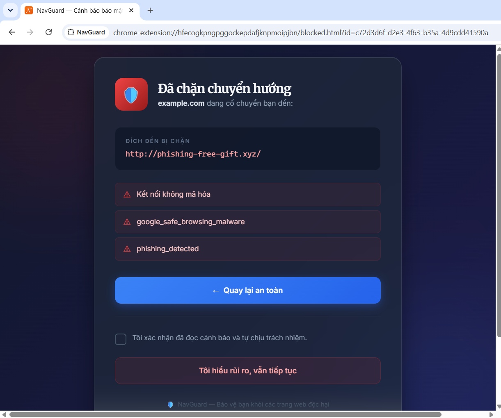
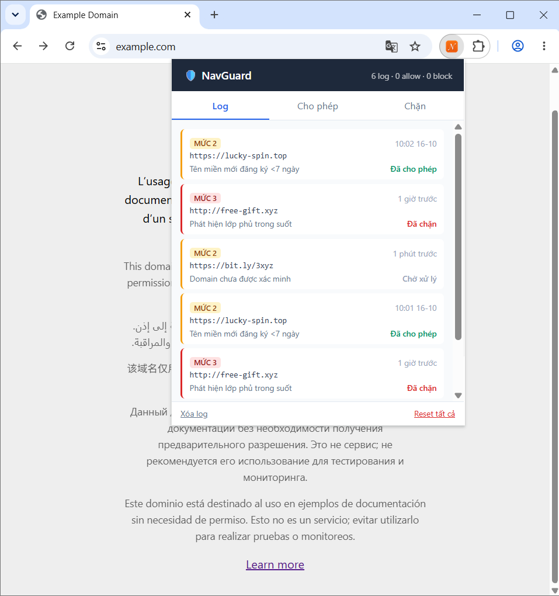
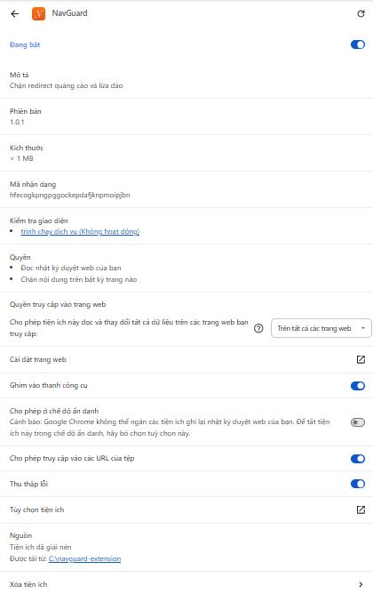
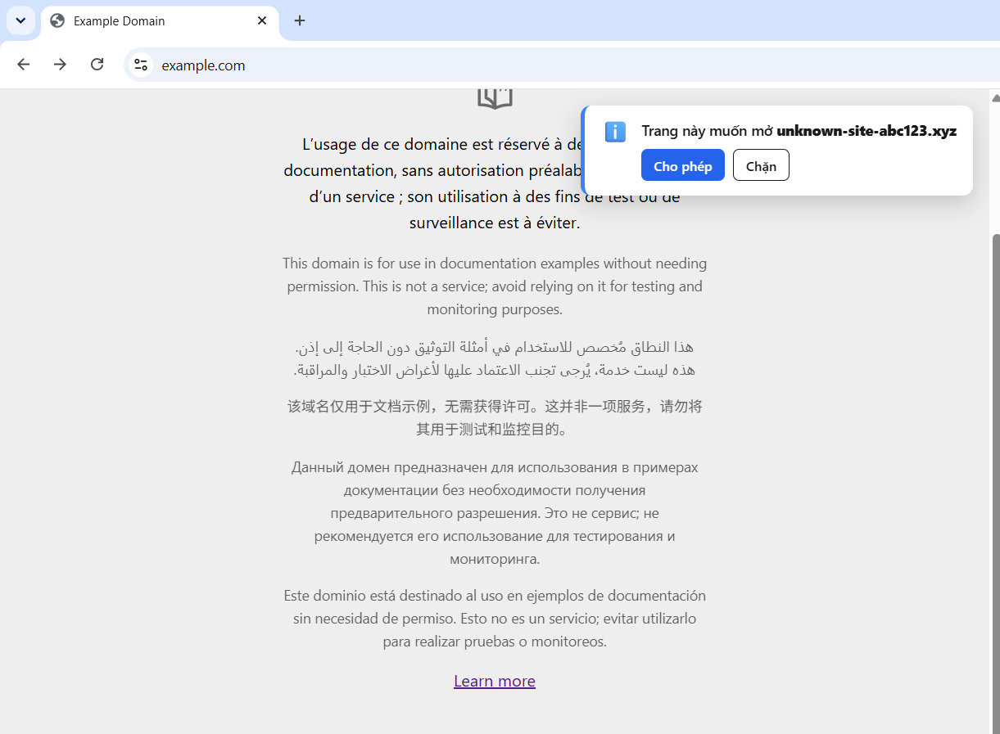

# 🛡️ NavGuard v1.0.2 — Hệ thống chặn Redirect Quảng Cáo & Lừa Đảo

**NavGuard** là một giải pháp bảo mật toàn diện (bao gồm Chrome Extension và Backend API Server) giúp bảo vệ người dùng khỏi các cuộc tấn công mạng phổ biến: Clickjacking (lớp phủ trong suốt), tự động chuyển hướng độc hại (Malicious Redirects), lừa đảo trực tuyến (Phishing) và quảng cáo xâm nhập.

## 👨‍💻 Tác giả
- **Họ và tên:** Nguyễn Tiến Đạt
- **Sinh viên:** Ngành Khoa học máy tính
- **Trường:** Trường Đại học Bách khoa - Đại học Quốc gia Thành phố Hồ Chí Minh (HCMUT - VNU-HCM)

---

## 🚀 Có gì mới trong phiên bản 1.0.2?
Phiên bản này mang đến trải nghiệm lướt web mượt mà và an toàn tuyệt đối với 2 tính năng cốt lõi:
1. **Silent Blocking (Chặn im lặng trên RAM):** Khi người dùng chọn "Chặn", tên miền được đưa vào bộ nhớ đệm (RAM) ngay lập tức. Mọi cú click lỡ tay sau đó vào quảng cáo sẽ bị "bốc hơi" mà không hề hiện bảng cảnh báo (Interstitial) làm gián đoạn trải nghiệm.
2. **Tab-Scoped Session Allowlist (Cho phép tạm thời theo Tab):** Khi người dùng chọn "Cho phép", tên miền chỉ được lưu trong phiên của Tab hiện tại. Nếu người dùng đóng Tab hoặc F5, quyền cho phép sẽ bị thu hồi. Lần sau click lại, hệ thống sẽ hỏi lại từ đầu (bảo vệ người dùng khỏi việc vô tình tin tưởng quảng cáo mãi mãi).

## 🌟 Tính năng nổi bật
- **Bắt trọn mọi điều hướng:** Phát hiện không chỉ click chuột, mà còn cả script tự động chuyển hướng (`window.open`, `meta refresh`, `history.pushState`).
- **Phát hiện Clickjacking:** Thuật toán nhận diện lớp phủ trong suốt (Overlay).
- **Smart Decision (Quyết định thông minh):** Kết hợp với Backend Server để phân tích tuổi đời tên miền (RDAP) và danh sách đen. Tự động cho qua nếu uy tín, tự động chặn nếu nguy hiểm.
- **Giao diện đỉnh cao:** Màn hình cảnh báo thiết kế theo phong cách Glassmorphism (Kính mờ), font chữ chuẩn bảo mật.
- **Quản lý linh hoạt:** Trang Options cho phép tùy chỉnh mức độ cảnh báo. Popup quản lý Allowlist/Blocklist.

---

## ⚙️ Chi tiết Logic Hoạt động (Core Logic)

Hệ thống NavGuard hoạt động dựa trên sự kết hợp chặt chẽ giữa **Extension (Client)** và **Server API (Backend)**.

### 1. Lớp Bắt Sự Kiện (Detection Layer - Extension)
Extension sử dụng 3 lớp phòng thủ để bắt mọi hành vi chuyển hướng:
- **Content Script (Capture Phase):** Bắt sự kiện click toàn trang. Kiểm tra xem người dùng có thực sự click không (`isTrusted`), click vào link hay click vào một vùng trống.
- **Injected Script (Main World):** Chèn mã độc lập vào trang web để "móc nối" (hook) các hàm hệ thống:
  - Hook `window.open`: Bắt các tab popup tự động mở.
  - Hook `history.pushState`: Bắt các trang web giả mạo URL.
  - Hook `location.assign`: Bắt script tự động đổi trang.
  - MutationObserver: Theo dõi và bắt thẻ `<meta http-equiv="refresh">`.
- **Phân tích Clickjacking:** Khi người dùng click, Extension lấy phần tử trên cùng tại tọa độ đó (`elementFromPoint`). Nếu phần tử đó có độ mờ `opacity < 0.15`, phủ toàn màn hình và không có nội dung -> Kết luận là Overlay độc hại.

### 2. Bộ Não Quyết Định (Decision Engine - Extension)
Mỗi khi phát hiện hành vi chuyển hướng, Extension thu thập dữ liệu và tính điểm rủi ro (Risk Score):
- **Cộng điểm:** Không có thao tác người dùng (+40), Overlay (+35), Meta refresh (+25), Lệch link (+25), Giao thức HTTP/HTTPS (+20).
- **Trừ điểm:** Nằm trong Allowlist (-60), Cùng tên miền gốc và an toàn (-50).
- **Phân loại 4 Mức:**
  - **Level 0 (Im lặng):** Điểm < 0, cùng origin, hoặc Server báo domain "High Trust". Tự động cho qua.
  - **Level 1 (Toast Xanh):** Domain lạ, không có dấu hiệu lừa đảo. Hiện thông báo nhẹ.
  - **Level 2 (Toast Đỏ):** Có dấu hiệu đáng ngờ (Iframe, lệch link, rủi ro trung bình).
  - **Level 3 (Interstitial):** Có Overlay, Meta refresh, rủi ro cao, hoặc Server báo domain "Low Trust".

### 3. Xử lý 2 Trường hợp thực tế (TH1 & TH2)
- **TH1 (Chặn vĩnh viễn):** Khi người dùng bấm **"Chặn"**, tên miền được đưa ngay vào `policy.blocklist` trên RAM. Ở các lần click tiếp theo (kể cả lỡ tay), Background sẽ chặn đứng (Silent Block) mà không cần hỏi lại, không hiện bảng Interstitial, không làm gián đoạn công việc.
- **TH2 (Cho phép tạm thời):** Khi người dùng bấm **"Cho phép"**, tên miền được lưu vào `chrome.storage.session` theo `tabId`. Nếu người dùng F5 hoặc tắt Tab, hệ thống lập tức nghe ngóng sự kiện `chrome.tabs.onRemoved` và `webNavigation.onCommitted` để xóa session. Lần sau quay lại, hệ thống sẽ kiểm tra lại từ đầu.

### 4. Phân Tích Tên Miền (Backend Server)
Khi Extension cần đánh giá một tên miền, nó gọi API `POST /v1/reputation`:
- **Kiểm tra Redis Cache:** Nếu domain đã được check trong 24h, trả kết quả ngay.
- **Kiểm tra RDAP (Domain Age):** Truy vấn hệ thống đăng ký tên miền.
  - Tuổi đời < 7 ngày: Rất nguy hiểm (Phạt 40 điểm).
  - Tuổi đời > 1 năm: Rất uy tín (Thưởng 30 điểm).
- **Safe Browsing:** Đối chiếu từ khóa với danh sách đen (Malware/Phishing).
- **Trả kết quả:** `level` (high/medium/low) và `score`.

---

## 📁 Cấu trúc dự án
- `extension/`: Chrome Extension (Manifest V3, TypeScript, Vite).
- `server/`: Backend API (Fastify, Redis, PostgreSQL).
- `scripts/`: Các script khởi động tự động.
- `docs/`: Tài liệu test và hình ảnh.

---

## 📸 Thư viện Hình ảnh (Gallery)

**1. Màn hình cảnh báo nguy hiểm (Interstitial Page - Glassmorphism)**

**2. Quản lý Log và Danh sách (Popup UI)**

**3. Trang Cài đặt (Options Page)**

**4. Cảnh báo nhẹ trên trang web (Toast UI)**

**5. Icon Extension**

---

## 🚀 Hướng dẫn cài đặt và Khởi chạy

### Yêu cầu hệ thống
- Node.js 20+ & pnpm
- Docker & Docker Compose
- Trình duyệt Chrome/Edge/Coccoc

### Chạy Local (Dành cho Dev)
1. **Khởi động Server & Database:**
   `~/navguard/scripts/start-all.sh`
   *(Script này sẽ bật Docker Postgres/Redis, build Extension và chạy Server tại `http://localhost:3000`)*

2. **Cài đặt Extension vào Chrome:**
   - Mở Chrome, truy cập `chrome://extensions/`
   - Bật **Developer mode**.
   - Bấm **Load unpacked**.
   - Chọn thư mục `C:\navguard-extension`.

---

## 🧪 Kiểm thử (Testing)
Chạy Unit Test cho Extension (Vitest):
`cd ~/navguard/extension && pnpm test`

---

## 🛡️ Giấy phép (License)
Dự án được thực hiện cho mục đích học tập và nghiên cứu bảo mật tại Trường Đại học Bách khoa - ĐHQG TP.HCM. Vui lòng ghi rõ nguồn tác giả nếu sử dụng lại mã nguồn.
